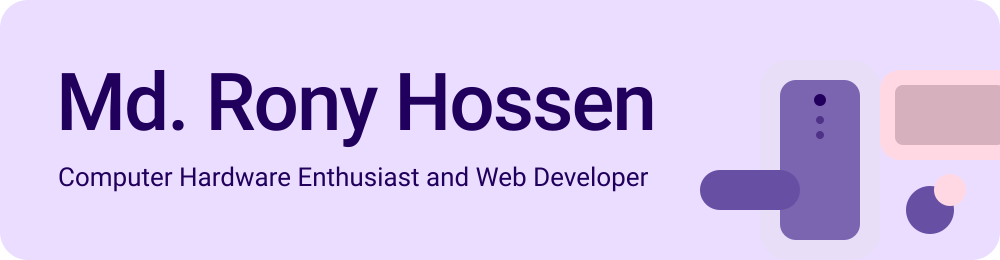

<picture><source media="(prefers-color-scheme: dark)" srcset="assets/dark/hero.svg"></picture>

Cloud computing, IoT, and the systems that connect hardware to software.

<a href="mailto:rony.hossen.duet@gmail.com"><picture><source media="(prefers-color-scheme: dark)" srcset="assets/dark/btn-email.svg"></picture></a> <a href="https://www.linkedin.com/in/rony1duet/"><picture><source media="(prefers-color-scheme: dark)" srcset="assets/dark/btn-linkedin.svg"></picture></a> <a href="https://github.com/rony1duet"><picture><source media="(prefers-color-scheme: dark)" srcset="https://hits.sh/github.com/rony1duet.svg?style=flat-square&label=Views&color=D0BCFF"></picture></a> <a href="https://rony1duet.github.io/gitcodehub/"><picture><source media="(prefers-color-scheme: dark)" srcset="assets/dark/btn-portfolio.svg"></picture></a> <a href="https://t.me/rony1duet"><picture><source media="(prefers-color-scheme: dark)" srcset="assets/dark/btn-telegram.svg"></picture></a>

## About

Hey, I'm Md. Rony Hossen, a computer hardware enthusiast and web developer studying at Dhaka University of Engineering & Technology, Gazipur, Bangladesh.

I enjoy figuring out how things work and turning ideas into something real. Sometimes that means building custom Android ROMs for the Redmi Note 12 Pro 4G or working on OpenCore EFI configurations. Other times, it's developing Kotlin applications, building websites, or creating Windows desktop tools that solve real-world problems.

Over time, I've explored different technologies, including Android, Kotlin, PHP, C#, and TypeScript. Some of the projects I've worked on include the DUET Mosque Connect app, OpenCore EFI, Chokkhori Magazine and Resume Builder website, WinCalc Windows app, XORA for the NASA Space Apps Challenge, SecureChat mobile application, and Secure LAB Setup a project focused on fair lab examinations. Each project gives me an opportunity to learn something new, experiment with ideas, and become a better developer.

What fascinates me most is the intersection of hardware and software understanding what happens under the hood and discovering how technology can solve practical problems. I'm currently exploring IoT and AI/ML while continuing to learn, experiment, and contribute to the open-source community.

I'm still learning, still building, and always curious about what I can create next. For me, engineering is about staying curious, solving problems, sharing knowledge, and turning ideas into things that actually work.

## Tech stack

| Area | Skills |
| --- | --- |
| **Languages** |     |
| **Web** |    |
| **Cloud & DevOps** |    |
| **Data & APIs** |    |
| **Hardware & tools** |    |

## Featured projects

| Project | What it does |
| --- | --- |
| **[Chokkhori Magazine](https://github.com/rony1duet/ChokkhoriMagazine)**   Web Developer | A modern, lightweight, PHP-based web magazine built for Bengali literature enthusiasts, featuring dynamic content management. |
| **[WinCalc](https://github.com/rony1duet/WinCalc)**   Desktop Developer | A Windows calculator application built with C# and Visual Studio 2022, supporting basic arithmetic operations through a clean interface. |
| **[DUET Mosque Connect](https://github.com/rony1duet/DUET_Mosque_Connect)**   Android Developer | An Android application built with Kotlin to support mosque community connectivity and management at DUET. |
| **[SecureChat](https://github.com/rony1duet/SecureChat-ThirdParty-API)**   App Developer | A mobile messaging application integrating third-party APIs to deliver its core communication features. |
| **[Secure LAB Setup](https://github.com/rony1duet/SecureLabSetup)**   Hardware & Software Developer | A project focused on creating a more secure and fair environment for laboratory examinations. |
| **[gitcodehub](https://github.com/rony1duet/gitcodehub)**   Web Developer | A responsive portfolio website showcasing projects, technical skills, and development work. |
| **[XORA](https://github.com/rony1duet/XORA)**   Software Developer | A TypeScript-based project exploring modern web technologies and software development. |

[View all projects on GitHub](https://github.com/rony1duet?tab=repositories)

## GitHub activity

<picture><source media="(prefers-color-scheme: dark)" srcset="https://github-readme-stats-fast.vercel.app/api?username=rony1duet&show_icons=true&hide_border=true&border_radius=24&bg_color=211F26&title_color=D0BCFF&text_color=CAC4D0&icon_color=EFB8C8"></picture>

<picture><source media="(prefers-color-scheme: dark)" srcset="https://streak-stats.demolab.com/?user=rony1duet&hide_border=true&border_radius=24&background=211F26&ring=D0BCFF&fire=EFB8C8&currStreakNum=CAC4D0&sideNums=CAC4D0&currStreakLabel=D0BCFF&dateRangeLabel=D0BCFF&dates=CAC4D0&excludeDaysLabel=D0BCFF&sideLabels=D0BCFF&stroke=49454E"></picture>

<picture><source media="(prefers-color-scheme: dark)" srcset="https://github-readme-stats-fast.vercel.app/api/top-langs/?username=rony1duet&layout=compact&hide_border=true&border_radius=24&bg_color=211F26&title_color=D0BCFF&text_color=CAC4D0"></picture>

## Connect

I'm open to conversations, collaboration, and new projects.

 

<a href="mailto:rony.hossen.duet@gmail.com"><picture><source media="(prefers-color-scheme: dark)" srcset="assets/dark/btn-email.svg"></picture></a> <a href="https://www.linkedin.com/in/rony1duet/"><picture><source media="(prefers-color-scheme: dark)" srcset="assets/dark/btn-linkedin.svg"></picture></a> <a href="https://rony1duet.github.io/gitcodehub/"><picture><source media="(prefers-color-scheme: dark)" srcset="assets/dark/btn-portfolio.svg"></picture></a> <a href="https://t.me/rony1duet"><picture><source media="(prefers-color-scheme: dark)" srcset="assets/dark/btn-telegram.svg"></picture></a>
 

Exploring where hardware, software, and the cloud meet.

